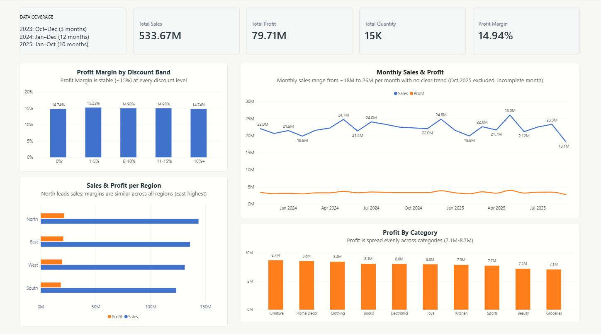

# E-commerce Sales Analysis | SQL & Power BI

## Business Question
Which regions, product categories, and discount levels drive profit for this e-commerce business, and where should growth come from?

## Dashboard Preview

## Key Insights
- **Note:** The dataset covers different periods for each year, so annual comparisons should be interpreted with caution.
- **Overall performance:** ₹533.67M in sales, ₹79.71M in profit, and a 14.94% profit margin across about 5,000 orders.
- **Discounts do not visibly affect margin.** Across five discount bands of roughly 1,000 orders each, profit margin stays between 14.7% and 15.2%. Orders with no discount earn 14.74% and orders with 16%+ discounts earn 14.74%.
- **Sales are stable over time.** Monthly sales range from about ₹18M to ₹26M with no clear upward or downward trend (October 2025 excluded because the month is incomplete).
- **North leads sales; regions are similar on profitability.** Margins differ by only a few tenths of a percentage point, with East slightly highest.
- **Profit is spread evenly across categories**, from ₹7.1M (Groceries) to ₹8.7M (Furniture). No category dominates.

## Recommendations
- **Discounting is not a profitability lever in this dataset.** Heavy discounts did not reduce margin, but they did not show a clear benefit either, so test whether discounts actually increase order volume before expanding them.
- **Growth should come from sales volume.** Margins are uniform across regions, categories, and discount levels, so no segment is clearly worth favouring for profitability alone.
- **Investigate drivers of volume in the strongest region (North)**, such as order count versus basket size, to see whether its performance can be replicated elsewhere.

## Tools Used
- **MySQL:** Data cleaning, data validation, and exploratory data analysis
- **Power BI:** Dashboard development and data visualization
- **DAX:** Creation of measures and key performance indicators (KPIs)

## Data Preparation
- Converted order dates to the appropriate date format.
- Checked for duplicate records.
- Identified and corrected a customer name encoding issue.
- Performed data quality checks on payment methods.

## Data
- **Source:** E-Commerce sales by Prince Rajak, Kaggle (https://www.kaggle.com/datasets/prince7489/e-commerce-sales?resource=download)
- **Size:** about 5,000 orders
- **Process:** downloaded from Kaggle as a spreadsheet, imported into MySQL, then cleaned and analysed with SQL before visualising in Power BI
- **Coverage:** Oct–Dec 2023 (3 months), Jan–Dec 2024 (12 months), Jan–Oct 2025 (10 months). Because coverage differs by year, trends are shown monthly and not as yearly totals.
- **Currency:** all monetary values are in Indian rupees (₹)
